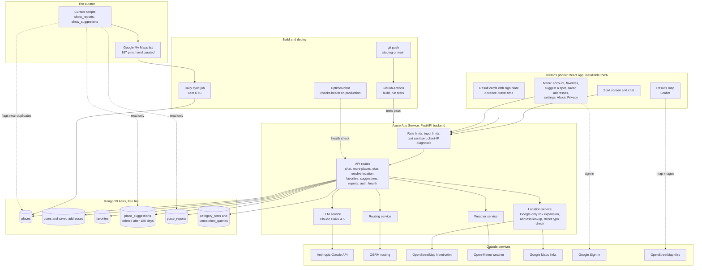

# TLV Bot - how it fits together

Two diagrams, both written in Mermaid (GitHub renders them on this page).
Regenerate or edit them in any Mermaid editor; keep them in step with
`CLAUDE.md` when the architecture changes.

## System overview

Who touches what: the visitor's phone, the FastAPI app on Azure, the MongoDB
collections, the outside services, the curator's tooling and the build and
deploy pipeline. Dotted lines are optional, read-only or occasional.

## What happens when someone asks for food

One chat message, from the craving to the travel time landing in the card.
The decisions in the middle are the honest-reply rules: a failed model call, a
request that is not about food, a requirement the list cannot honour, and a
place named in the message are each said out loud instead of hidden.

