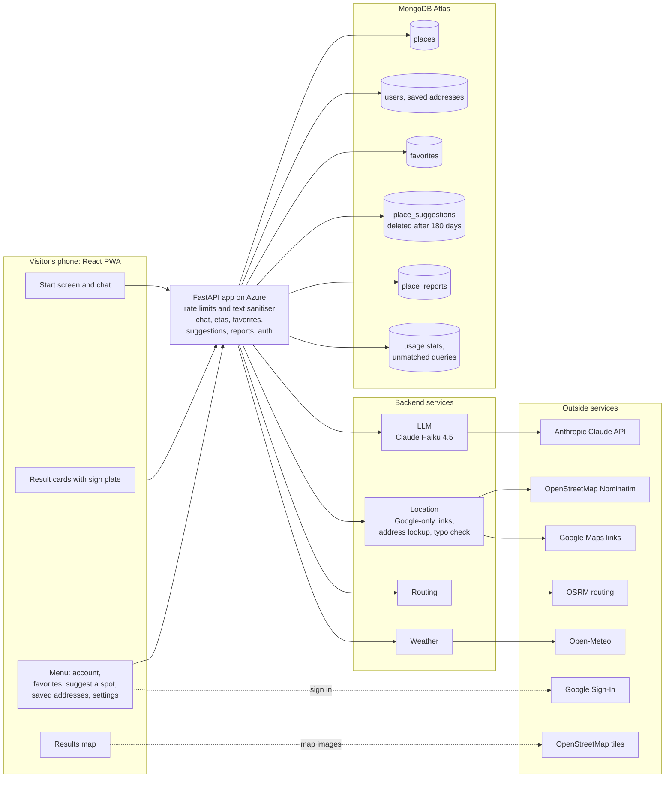
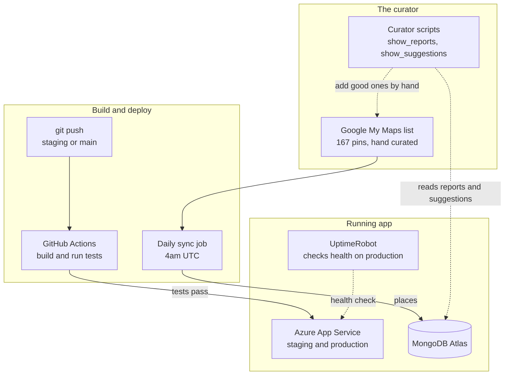
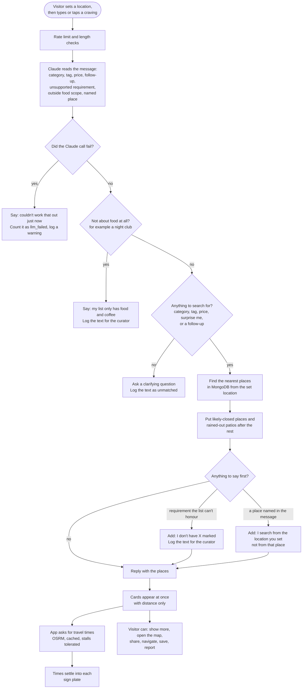

# TLV Bot - how it fits together

Three diagrams, written in Mermaid (GitHub renders them on this page). Edit
them in any Mermaid editor, and keep them in step with `CLAUDE.md` when the
architecture changes.

## What runs

The visitor's phone, the FastAPI app on Azure and its services, the MongoDB
collections, and the outside services it calls. Dotted lines are optional or
occasional.

## Who looks after it

The curator's list and scripts, the build and deploy pipeline, and the running
app they feed. Dotted lines are read-only or occasional.

## What happens when someone asks for food

One chat message, from the craving to the travel time landing in the card. The
decisions in the middle are the honest-reply rules: a failed model call, a
request that is not about food, a requirement the list cannot honour, and a
place named in the message are each said out loud instead of hidden.

